# Thiết kế kiến trúc PoC RAG HCMUTE — bản làm việc Mốc 2

**Trạng thái:** Bản thiết kế ban đầu, đối chiếu với code đang có; chưa phải tuyên bố hệ thống đã hoàn chỉnh hoặc được đánh giá end-to-end.

**Phạm vi:** PoC console hỏi đáp trên tài liệu học vụ HCMUTE; giữ dữ liệu cục bộ và có thể truy ngược bằng chứng.
**Cơ sở:** `src/rag_hcmute/`, `configs/project.json`, `docs/TRUY_VET_YC.md` và các evidence trong `docs/evidence/`.

## 1. Bài toán và ranh giới hệ thống

PoC nhận câu hỏi tiếng Việt về nội dung có trong tài liệu học vụ đã đưa vào corpus. Hệ thống tìm các đoạn liên quan, có thể gửi các đoạn đó cùng câu hỏi tới LLM chạy cục bộ, rồi hiển thị câu trả lời và vị trí nguồn để người dùng mở lại PDF đối chiếu.

Đây không phải cổng thông tin học vụ, chatbot kiến thức tổng quát hay nơi tra cứu lịch học/lịch thi đang thay đổi. Hệ thống không tự xác nhận hiệu lực pháp lý của văn bản, không quyết định quyền lợi của sinh viên và không được xem là đáng tin cậy chỉ vì câu trả lời có citation. Một citation hợp lệ về cú pháp mới chứng minh được nguồn tồn tại trong danh sách đã truy xuất; nó chưa chứng minh nguồn đó thực sự hỗ trợ nội dung câu trả lời.

## 2. Luồng kiến trúc hiện có

```mermaid
flowchart TD
    subgraph Offline["Luồng chuẩn bị dữ liệu — chạy trước khi hỏi đáp"]
        A["PDF học vụ và corpus manifest"] --> B["Kiểm tra file, nguồn và SHA-256"]
        B --> C["PyMuPDF: trích xuất theo trang"]
        C --> D["OCR Tesseract tùy chọn, chỉ bật rõ ràng"]
        D --> E["Làm sạch header/footer lặp"]
        E --> F["Nhận diện Chương/Điều nếu đủ dấu hiệu"]
        F --> G["Chunk có metadata và provenance"]
        G --> H["Pages JSONL, chunks JSONL, snapshot manifest"]
        H --> I1["BM25 index"]
        H --> I2["BGE-M3 embeddings + FAISS IndexFlatIP"]
    end

    subgraph Online["Luồng truy vấn — PoC console"]
        Q["Câu hỏi tiếng Việt"] --> R1["BM25 lexical retrieval"]
        Q --> R2["Dense retrieval cục bộ"]
        R1 --> FUSION["RRF: hợp nhất theo thứ hạng"]
        R2 --> FUSION
        R1 --> TOP["Kết quả retrieval"]
        R2 --> TOP
        FUSION --> TOP
        TOP --> RR["BGE cross-encoder reranker tùy chọn"]
        RR --> CTX["Top-k chunks + metadata nguồn"]
        TOP --> CTX
        CTX --> GEN["Qwen3:4B qua Ollama loopback, tùy chọn"]
        GEN --> CHECK["Kiểm tra JSON và citation ID"]
        CHECK --> OUT["Câu trả lời thử nghiệm + vị trí nguồn"]
        CHECK --> REFUSE["Từ chối khi lỗi cấu trúc/thiếu nguồn"]
    end

    classDef local fill:#fff,stroke:#222,color:#111;
    class A,B,C,D,E,F,G,H,I1,I2,Q,R1,R2,FUSION,TOP,RR,CTX,GEN,CHECK,OUT,REFUSE local;
```

Sơ đồ thể hiện hai luồng khác nhau: dựng corpus/index là tác vụ offline; truy vấn là tác vụ console. OCR, Dense/Hybrid, reranker và generation không phải điều kiện mặc định cho mọi lần chạy. Trong benchmark G0, baseline vẫn được giữ tách biệt để các ablation có thể so trên cùng snapshot.

## 3. Trách nhiệm module và dữ liệu đi qua các tầng

| Tầng | Module hiện có | Đầu vào → đầu ra | Điều cần kiểm soát |
|---|---|---|---|
| Nguồn và manifest | `ingestion/manifest.py`, `data/manifests/` | Metadata tài liệu, file PDF → kết quả audit/hash | Tên file tồn tại, SHA-256 khớp, nguồn và trạng thái văn bản được ghi nhận; audit schema không đồng nghĩa corpus có nội dung phù hợp |
| Trích xuất trang | `ingestion/extract.py` | PDF → `PageText` theo số trang PDF | Lưu `document_id`, `pdf_page`, text, dấu hiệu scan, số trang in nếu nhận diện, phương thức native/OCR; OCR hiện là nhánh opt-in |
| Làm sạch và cấu trúc | `ingestion/clean.py`, `ingestion/sectioning.py` | Các trang → trang làm sạch và marker Chương/Điều | Chỉ loại header/footer lặp đã nhận diện; heuristic Điều có thể bỏ sót văn bản có format khác hoặc nhầm nội dung được trích dẫn |
| Chunk và snapshot | `ingestion/chunk.py`, `ingestion/pipeline.py` | Trang + cấu hình → chunk JSONL và snapshot ID | Giữ trang bắt đầu/kết thúc, `section_path`, phương thức chunk, extraction method, hash nội dung và token offsets; kích thước token hiện dùng whitespace split, không phải tokenizer của LLM |
| Retrieval | `retrieval/bm25_index.py`, `dense_index.py`, `hybrid.py` | Câu hỏi + chunks → `RetrievalHit` có hạng/điểm/metadata | BM25 và Dense đo tín hiệu khác nhau; RRF hợp nhất hạng chứ không cộng raw score; các nhánh phải dùng cùng tập chunk |
| Reranking | `retrieval/reranked.py`, `evaluation/reranker.py` | Candidate pool → danh sách được xếp hạng lại | Reranker chỉ sắp xếp lại ứng viên đã tìm thấy; không cứu evidence vắng khỏi candidate pool; cần theo dõi truncation và latency |
| Generation | `generation/ollama.py` | Câu hỏi + `GroundingSource` → `GroundedAnswer` | Chỉ gọi Ollama loopback; kiểm schema/citation ID; hiện chưa có bộ kiểm tra entailment hoặc ngưỡng từ chối đã hiệu chỉnh |
| Điều phối console | `console_app.py` | Tham số CLI/câu hỏi → output cho người dùng | In executable Python, model local phải được chỉ định, không tự tải model; console hiện là PoC, chưa phải dịch vụ nhiều người dùng |
| Đánh giá | `evaluation/`, `scripts/run_*`, `scripts/prepare_manual_review.py`, `scripts/summarize_manual_reviews.py` | Snapshot + câu hỏi đã duyệt + gold → retrieval metrics và phiếu chấm generation thủ công | Tách retrieval khỏi generation; khóa một run/snapshot/partition mỗi lần tổng hợp; semantic labels vẫn cần người học duyệt |

### 3.1 Hợp đồng dữ liệu chính

- **`PageText`** là đơn vị trích xuất có định danh tài liệu và số trang PDF gốc. `printed_page` có thể khác trang PDF và có thể không nhận diện được.
- **`Chunk`** mang `chunk_id`, `document_id`, tiêu đề, khoảng trang PDF/trang in, mục/điều nếu nhận diện được, nội dung, hash, cách chunk, extraction method và khoảng token tài liệu. Citation của PoC hiện truy ngược về chunk/trang; chưa có tọa độ đoạn hoặc bounding box để tô sáng trên PDF.
- **`RetrievalHit`** giữ ID chunk, vị trí nguồn, score, rank và preview. Preview ngắn dùng cho output/log; generation lấy toàn văn chunk từ map ID→chunk.
- **`GroundingSource`** gán ID tạm thời như `S1` cho các chunk được đưa vào prompt. Đầu ra chỉ chấp nhận citation ID thuộc danh sách này; quan hệ giữa một claim cụ thể và câu chữ nguồn vẫn cần đánh giá ngữ nghĩa riêng.

Các trường trên là hợp đồng hiện có, không nên gọi là chuẩn hóa đầy đủ cho mọi loại tài liệu. Đặc biệt, bảng được chuyển đổi cần provenance riêng; metadata trang/mục chưa đảm bảo bảo toàn quan hệ ô gộp hoặc tiêu đề nhóm.

## 4. Phân loại đầu vào và cách xử lý hiện tại

“Document Class” mô tả loại tài liệu ở cấp nguồn; scan, bảng, hình và layout là đặc điểm có thể thay đổi ngay trong một tài liệu. Vì vậy không gán một cách xử lý duy nhất cho cả PDF chỉ từ tên tài liệu.

| Dạng đầu vào | Cách hệ thống hiện xử lý | Rủi ro còn lại / điều kiện dùng |
|---|---|---|
| PDF có lớp chữ tương đối sạch | PyMuPDF lấy text theo trang; bước làm sạch và chunking tiếp theo | Thứ tự đọc nhiều cột, bảng và header/footer bất thường có thể không giữ đúng ngữ nghĩa |
| Trang scan toàn trang | Phát hiện ảnh phủ diện tích lớn; OCR chỉ chạy khi cấu hình được bật | CER/WER và khôi phục token trên mẫu nhỏ chưa đủ để dùng số, điều kiện, phủ định OCR như bằng chứng tự động |
| Trang pha text và ảnh | Có phát hiện ảnh; native text được ưu tiên trừ khi điều kiện OCR opt-in khớp | Hình/biểu đồ có thể mang thông tin không có trong lớp chữ; hiện chưa có image understanding pipeline |
| Bảng | Có serializer Markdown/hàng theo dữ liệu đã được người học đối chiếu | Chưa phải parser tự động; không tự forward-fill ô trống hoặc suy luận ô gộp; chỉ áp dụng cho ablation đã kiểm tra |
| Văn bản có Chương/Điều | Dò marker theo dòng, rồi giới hạn chunk theo Điều khi đủ dấu hiệu | Heuristic có thể không bắt được cấu trúc đánh số khác; mẫu hiện tại không đại diện mọi văn bản |
| Văn bản không có cấu trúc Điều rõ | Fallback sang cửa sổ trượt | Chia cắt có thể làm mất quan hệ giữa tiêu đề, điều kiện và ngoại lệ; cần đánh giá bằng evidence spans |

Không đưa QĐ 3116 vào corpus trả lời chỉ vì OCR đã chạy được. Tài liệu đó vẫn cần transcript/gold được đối chiếu và kiểm tra hiệu lực, phạm vi áp dụng trước khi có thể dùng làm nguồn trả lời.

## 5. Quyết định kỹ thuật hiện tại và trạng thái

| Thành phần | Baseline/biến thể trong code | Trạng thái diễn giải |
|---|---|---|
| Ngôn ngữ và runtime | Python 3.11 trong môi trường riêng | Môi trường PoC đã được xác lập; mỗi lần chạy cần gọi đúng Python của env |
| PDF | PyMuPDF | Đã dùng trong pipeline; bố cục phức tạp vẫn là giới hạn |
| OCR | Tesseract tiếng Việt, DPI/PSM cấu hình được | Tùy chọn và được đo trên mẫu nhỏ; chưa đổi default native-only của snapshot G0 |
| Chunking | Ưu tiên ranh giới Điều khi nhận diện; nếu không thì sliding window 500/80 | Cấu hình khởi đầu; phép thử trên pilot cho xu hướng trái chiều theo BM25/Dense, chưa chốt tối ưu |
| Lexical retrieval | BM25Okapi | Baseline dễ giải thích; có rủi ro với đồng nghĩa/cách diễn đạt khác |
| Dense retrieval | BGE-M3 + FAISS IndexFlatIP | Baseline dense đã chạy cục bộ; kết quả G0 development nhỏ, không đại diện benchmark độc lập |
| Hybrid | BM25 + Dense, Reciprocal Rank Fusion (`k=60`) | Biến thể đã đo; trên pilot không vượt Dense, không tự động được xem là tốt hơn |
| Reranker | BGE-Reranker-v2-m3 local | Chỉ trên candidate pool; latency/truncation cần tính vào thiết kế và báo cáo |
| Generator | Qwen3:4B qua Ollama loopback | Chỉ thử local; refusal và ngữ nghĩa citation chưa đạt kiểm chứng |
| Vector store bổ sung | Qdrant local đã có phép thử exact; Chroma/Milvus/Pinecone chưa là baseline | Không đưa kết quả capability/tài liệu hãng thành số đo thực nghiệm; cân nhắc theo persistence, metadata filter, vận hành và quyền dữ liệu |

Lựa chọn chưa đủ căn cứ để ghi “tối ưu” gồm chunk size, loại retriever tốt nhất, RRF cutoff, reranker, ngưỡng từ chối và LLM có chất lượng câu trả lời cao nhất. Mỗi kết luận cần dựa trên cùng corpus/split và ghi rõ số câu, số evidence, cấu hình, thời gian và giới hạn.

## 6. Các điểm lỗi kiến trúc cần đánh giá ở Mốc 2

1. **Corpus lệch phiên bản:** manifest hoặc PDF không khớp hash làm cho metric/citation không tái lập. Build phải dừng hoặc đánh dấu tài liệu bị bỏ qua rõ ràng.
2. **Trang và điều khoản bị nhầm:** số trang in không phải lúc nào cũng bằng số trang PDF. Output hiện ưu tiên số trang PDF và điều khoản nhận diện được; cần nói rõ loại số trang.
3. **Chunk mất ngữ cảnh:** tiêu đề/ngoại lệ/điều kiện có thể nằm ở chunk khác. Cần giữ span bằng chứng làm tiêu chí, không chỉ dựa vào chunk ID hoặc trang gần đúng.
4. **OCR sai có vẻ hợp lệ:** OCR confidence không phải xác suất câu chữ đúng. Với mã, con số, điều kiện và phủ định, cần đối chiếu nguồn gốc trước khi đưa vào kho trả lời.
5. **Evidence không vào candidate pool:** reranker không thể khôi phục đoạn mà lexical/dense retrieval không trả về. Cần đo candidate coverage riêng trước khi kết luận reranker tốt hay xấu.
6. **LLM có citation nhưng không được nguồn hỗ trợ:** citation-ID validation hiện chỉ kiểm tra ID tồn tại. Mọi báo cáo chất lượng generation phải tách citation syntax khỏi citation entailment.
7. **Refusal chưa an toàn:** điểm reranker của hai nhóm đang chồng lấn trong pilot; không đặt ngưỡng sản phẩm từ mẫu này. Trạng thái hiện tại chỉ là thí nghiệm, không dùng tư vấn quy chế.
8. **Khác môi trường chạy:** model local, GPU/CUDA, snapshot và phiên bản package ảnh hưởng kết quả. Log cấu hình phải đủ để tái lập nhưng không ghi khóa, PII, câu hỏi hoặc toàn văn nguồn vào repo public.

## 7. Kiểm chứng kiến trúc trước khi hoàn tất Mốc 2

- **Kiểm chứng module:** manifest → extraction → cleaning/sectioning → chunks; xác minh số trang, chunk metadata, hash và snapshot ID.
- **Kiểm chứng retrieval:** BM25, Dense, Hybrid và reranker phải nhận cùng snapshot; lưu candidate depth, `top_k`, model revision, thời gian và truncation.
- **Kiểm chứng generation:** test nguồn rỗng, citation ID sai/thiếu, JSON lỗi, endpoint không loopback và Ollama không sẵn sàng. Các test cấu trúc không được diễn giải thành đo đúng/sai ngữ nghĩa.
- **Kiểm chứng câu trả lời:** cần bộ câu hỏi và gold evidence được người học duyệt; tách development với holdout, không dùng test để chọn prompt/ngưỡng.
- **Chấm ngữ nghĩa:** đã có rubric answer/claim, private bundle cục bộ và bộ tổng hợp nhãn; hiện chưa có answer nào được chấm semantic. Lượt generation pilot lặp lại không thay cho phần chấm này.
- **Kiểm chứng input class:** bổ sung mẫu theo PDF text, scan, bảng, nội dung hình và cấu trúc điều khoản; chỉ dùng nguồn người học đã xác nhận quyền truy cập và tính phù hợp.
- **Kiểm chứng vận hành:** console đủ cho PoC; không thêm UI/API nhiều người dùng nếu không phục vụ yêu cầu môn học. Ghi rõ thời gian khởi tạo model và thời gian từng tầng.

## 8. Kế hoạch tiếp nối

1. Dùng kiến trúc trong tài liệu này làm bản thiết kế làm việc, không coi thông số pilot là cấu hình tối ưu.
2. Hoàn thiện ma trận yêu cầu YC1–YC13 ↔ module ↔ test/evidence; giữ nguyên số thứ tự yêu cầu của giảng viên.
3. Chọn đúng một câu hỏi kiến trúc cho mỗi thử nghiệm tiếp theo để tránh thay đồng thời chunker, retrieval, reranker và prompt.
4. Chờ người học duyệt câu hỏi/gold và nguồn bổ sung; khi chưa có, chỉ chạy test kỹ thuật hoặc phép đo development được phân loại rõ.
5. Khi nội dung một mốc đã có bằng chứng, tạo bản DOCX mới theo format đã thống nhất. Không ghi đè demo gốc hay DOCX Mốc 1; chỉ đưa kết quả đã chạy và đã kiểm tra.

## 9. Tổ chức tài liệu nộp

- `D:\RAG\22110068_RAG_IT_Project_DEMO.docx` là bản demo ban đầu đã được giảng viên chốt; giữ nguyên như một mốc tham chiếu.
- `reports/22110068_RAG_Bao_Cao_Tien_Do_Dot_1_v6.docx` là báo cáo tiến độ Mốc 1 riêng; không thay thế file demo và không tuyên bố mọi YC1–YC13 đã hoàn thành.
- Các báo cáo tiếp theo được phát triển từ kết quả và phản hồi của mốc trước. Mỗi lần tạo bản DOCX mới cần giữ font Times New Roman, cỡ chữ và màu đen/trắng đã thống nhất, bố cục cân đối, đồng thời không sửa đè bản đã nộp.

## 10. Kiểm tra checkpoint

**Kiểm tra ngày 12/10/2026:** dùng Python `C:\Users\Dell\anaconda3\envs\rag-hcmute\python.exe` (Python 3.11, Torch `2.14.0+cu126`, CUDA khả dụng). Toàn bộ `pytest` đạt **105 passed**; `compileall` cho `src`, `scripts`, `tests` và `git diff --check` đều đạt. Test tích hợp `tests/test_rag_provenance_integration.py` chạy PDF fixture qua extraction → cleaning → chunking → BM25 → `GroundingSource` → generation mock; citation cuối giữ đúng chunk ID, document ID/title, trang PDF và section path.

Test trên chỉ xác nhận metadata được truyền xuyên pipeline và citation ID thuộc nguồn đã cấp; không chứng minh câu trả lời đúng hoặc nguồn hỗ trợ về ngữ nghĩa. Đây là kiểm tra hồi quy với PDF tổng hợp, không phải benchmark mới và không đóng các yêu cầu Mốc 1 còn thiếu. Test dùng response Ollama giả lập; không gọi Gemini/Ollama/cloud API, không tải model hay dependency.

## 11. Đánh giá thủ công generation — công cụ đã có, kết quả còn chờ chấm

- Rubric và quy trình cấp answer/claim: `docs/evaluation/manual_review_protocol.md`.
- Bundle có nội dung chỉ được tạo khi bật `--review-bundle-dir`; runner từ chối đường dẫn nằm trong repository. Mặc định cũ vẫn metrics-only.
- Script tạo phiếu `pending` chỉ gồm ID/metadata: `scripts/prepare_manual_review.py`; script tổng hợp nhãn đã chấm: `scripts/summarize_manual_reviews.py`. Một lần tổng hợp chỉ nhận một run, snapshot và partition; không sinh điểm tổng hợp.
- Bản chạy local 12/10 dùng lại G0 development 10 câu, Hybrid + reranker Top-5, Qwen3:4B qua Ollama. Kết quả vận hành lặp lại 7/7 answerable có phản hồi, 1/3 unanswerable bị từ chối. Đây là lần tái lập trên cùng bộ câu hỏi, không phải benchmark mới.
- Bundle nội dung và phiếu chấm nằm ở `D:\RAG\private_eval\`; không có câu hỏi, output hay source text nào trong repo. Answer/citation semantic chưa được chấm, do đó YC11 tiếp tục một phần và bước này không tự đóng Mốc 1.
